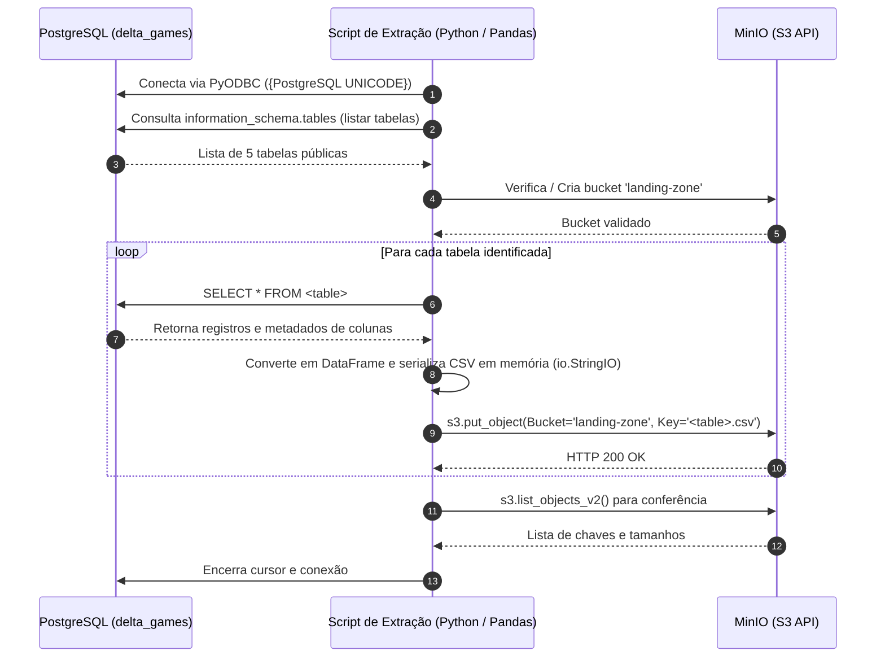

# Extração do Banco de Dados para a Landing Zone

Esta seção descreve a implementação técnica da extração de dados de um banco PostgreSQL e gravação dos dados em um CSV no Bucket Landing-Zone do MinIO.

**Notebook:**
[`01_database_to_landing_csv.ipynb`](file:///home/mateus/Code/Eng-Dados/apache-spark-minio/src/apache-spark-minio/notebooks/01_database_to_landing_csv.ipynb).

---

## **Fluxo de Dados e Arquitetura**

O processo de extração não gera arquivos temporários em disco. Ele lê os dados diretamente do PostgreSQL em memória através de cursores nativos e gera *streams* de bytes para upload direto na API S3 do MinIO:



---

## **Implementação Passo a Passo**

### 1. Carregamento de Dependências e Variáveis de Ambiente

As configurações de conexão com o banco relacional e com o serviço de *object storage* são carregadas a partir do arquivo `.env`:

```python
import os, io
import pandas as pd
import pyodbc
import boto3
from botocore.client import Config
from dotenv import load_dotenv

load_dotenv(override=True)

# Parâmetros do PostgreSQL
DB_HOST = os.getenv("HOST")
DB_PORT = os.getenv("PORT")
DB_NAME = os.getenv("DATABASE")
DB_USER = os.getenv("USER")
DB_PASS = os.getenv("PASSWORD")

# Parâmetros do MinIO
MINIO_ENDPOINT = os.getenv("MINIO_ENDPOINT")
MINIO_ACCESS_KEY = os.getenv("MINIO_ACCESS_KEY")
MINIO_SECRET_KEY = os.getenv("MINIO_SECRET_KEY")
MINIO_LANDING_BUCKET = os.getenv("MINIO_LANDING_BUCKET")
MINIO_BRONZE_BUCKET = os.getenv("MINIO_BRONZE_BUCKET")
```

---

### 2. Conexão com o PostgreSQL via ODBC

A comunicação com o banco utiliza o driver nativo `PostgreSQL UNICODE` gerenciado via `pyodbc`:

```python
conn = pyodbc.connect(
    "DRIVER={PostgreSQL UNICODE};"
    f"SERVER={DB_HOST},{DB_PORT};"
    f"DATABASE={DB_NAME};"
    f"UID={DB_USER};"
    f"PWD={DB_PASS};"
    "TrustServerCertificate=yes;"
)

cursor = conn.cursor()
print(f"Conectado ao postgres: {DB_NAME}")
```

---

### 3. Descoberta Dinâmica de Tabelas

Para garantir generalidade e evitar dependências estáticas de código, o catálogo de tabelas é inspecionado consultando o `information_schema.tables`:

```python
sql = """
SELECT table_name 
FROM information_schema.tables 
WHERE table_schema = 'public' 
  AND table_type = 'BASE TABLE' 
ORDER BY table_name;
"""

cursor.execute(sql)
result = cursor.fetchall()
tables = [line.table_name for line in result]
```

#### Contagem de Registros por Tabela

```python
for i, t in enumerate(tables, start=1):
    cursor.execute(f"SELECT COUNT(*) FROM public.{t};")
    print(f"{i:2d}. {t:<20} ({cursor.fetchone()[0]} registros)")
```

**Saída Obtida:**
```text
Tabelas encontradas: 5
----------------------------------------
 1. games                (21910 registros)
 2. how_long_to_beat     (13196 registros)
 3. regional_sales       (16608 registros)
 4. steam_metrics        (3178 registros)
 5. walkthrough_videos   (688 registros)
```

---

### 4. Provisionamento do Bucket no MinIO

O cliente S3 é configurado com a assinatura `s3v4` e apontando para o endpoint local do MinIO (`http://localhost:9000`). Em seguida, verifica-se de forma idempotente se o bucket `landing-zone` já existe:

```python
s3 = boto3.client(
    "s3",
    endpoint_url=MINIO_ENDPOINT,
    aws_access_key_id=MINIO_ACCESS_KEY,
    aws_secret_access_key=MINIO_SECRET_KEY,
    config=Config(signature_version="s3v4"),
    region_name="us-east-1"
)

try:
    s3.head_bucket(Bucket=MINIO_LANDING_BUCKET)
    print(f"Bucket: {MINIO_LANDING_BUCKET} já existe.")
except:
    s3.create_bucket(Bucket=MINIO_LANDING_BUCKET)
    print(f"Bucket: {MINIO_LANDING_BUCKET} criado.")
```

---

### 5. Extração e Carga em Memória (*In-Memory Buffer*)

Para cada tabela descoberta, o pipeline:<br><br>
1. Executa o `SELECT * FROM <tabela>`;<br>
2. Extrai os nomes das colunas via `cursor.description`;<br>
3. Constrói um `pandas.DataFrame`;<br>
4. Serializa o conteúdo no formato CSV utilizando um buffer em memória (`io.StringIO`);<br>
5. Transmite os bytes UTF-8 para o bucket `landing-zone` via chamada `put_object`:

```python
results = []

for t in tables:
    cursor.execute(f"SELECT * FROM {t};")
    columns = [desc[0] for desc in cursor.description]
    rows = cursor.fetchall()
    df = pd.DataFrame.from_records(rows, columns=columns)

    # Serialização em buffer de memória
    csv_buffer = io.StringIO()
    df.to_csv(csv_buffer, index=False)
    csv_bytes = csv_buffer.getvalue().encode("utf-8")
    s3_key = f"{t}.csv"

    # Envio para o MinIO
    s3.put_object(
        Bucket=MINIO_LANDING_BUCKET, 
        Key=s3_key, 
        Body=csv_bytes, 
        ContentType="text/csv"
    )

    size_kb = len(csv_bytes) / 1024
    results.append({
        "table": t, 
        "registros": len(df), 
        "colunas": len(df.columns), 
        "tamanho_kb": round(size_kb, 1)
    })
    print(f"{t}.csv -> s3://{MINIO_LANDING_BUCKET}/{s3_key} ({len(df)} registros, {size_kb:.1f} KB)")

print(f"\nExtração concluída: {len(tables)} tabelas exportadas.")
```

**Log da Execução:**
```text
games.csv -> s3://landing-zone/games.csv (21910 registros, 2355.9 KB)
how_long_to_beat.csv -> s3://landing-zone/how_long_to_beat.csv (13196 registros, 289.3 KB)
regional_sales.csv -> s3://landing-zone/regional_sales.csv (16608 registros, 495.6 KB)
steam_metrics.csv -> s3://landing-zone/steam_metrics.csv (3178 registros, 103.7 KB)
walkthrough_links.csv -> s3://landing-zone/walkthrough_links.csv (688 registros, 46.4 KB)

Extração concluída: 5 tabelas exportadas.
```

---

## **Métricas e Validação dos Dados Extraídos**

A listagem dos objetos diretamente no bucket `landing-zone` confirma a integridade e a persistência de todos os dados:

```python
response = s3.list_objects_v2(Bucket=MINIO_LANDING_BUCKET)
res = response.get("Contents", [])

for obj in res:
    print(f"{obj['Key']:<25} {obj['Size']/1024:>8.1f} KB")

df_resumo = pd.DataFrame(results)
print(f"\nTotal: {df_resumo['registros'].sum():,} registros | {df_resumo['tamanho_kb'].sum():,.1f} KB")
```

### Resumo Consolidado da Camada Landing Zone

| Arquivo CSV no MinIO | Tabela de Origem | Quantidade de Registros | Número de Colunas | Tamanho do Objeto (KB) |
| :--- | :--- | :---: | :---: | :---: |
| `games.csv` | `public.games` | **21.910** | 9 | `2.355,9 KB` |
| `how_long_to_beat.csv` | `public.how_long_to_beat` | **13.196** | 4 | `289,3 KB` |
| `regional_sales.csv` | `public.regional_sales` | **16.608** | 6 | `495,6 KB` |
| `steam_metrics.csv` | `public.steam_metrics` | **3.178** | 7 | `103,7 KB` |
| `walkthrough_videos.csv`| `public.walkthrough_videos`| **688** | 2 | `46,4 KB` |
| **Total Consolidado** | **5 tabelas** | **55.580** | — | **3.290,9 KB** |

---

## **Encerramento e Boas Práticas**

Ao final da execução, as conexões de banco de dados são devidamente finalizadas para liberar recursos do servidor:

```python
cursor.close()
conn.close()
print("Conexão com o banco encerrada")
```