# Pipeline de Dados: PostgreSQL, MinIO & Delta Lake

Documentação oficial do projeto prático de **Engenharia de Dados**. Este projeto implementa um pipeline moderno de dados unindo um banco de dados relacional (**PostgreSQL**), armazenamento de objetos distribuído compatível com S3 (**MinIO**) e processamento escalável em formato aberto (**Apache Spark & Delta Lake**).

---

## **Escopo do Trabalho Prático**

1. [**Extração para Landing Zone**](database_to_landing.md):
    Implementar a extração dos dados de todas as tabelas de um banco de dados relacional (PostgreSQL) e persistir em um bucket no MinIO denominado `landing-zone` no formato CSV.
2. [**Carga na Camada Bronze (Delta Lake)**](#):
    Ler os arquivos CSV do bucket `landing-zone` e gravá-los no formato **Delta Lake** em um novo bucket no MinIO chamado `bronze`.
3. [**Operações DML no Delta Lake**](#):
    Após a conversão para Delta Lake, reproduzir as 3 operações básicas de manipulação de dados — DML (`INSERT`, `UPDATE` e `DELETE`) — realizadas no laboratório anterior nas tabelas Delta Lake do bucket `bronze`.

---

## **Arquitetura do Pipeline**

A solução adota o paradigma de arquitetura em camadas (**Medallion Architecture / Data Lakehouse**):

```mermaid
flowchart LR
    subgraph SGBD["SGBD Relacional (Docker)"]
        PG[("PostgreSQL 18<br/>delta_games")]
    end

    subgraph MinIO["MinIO Object Storage (S3 API)"]
        subgraph LandingZone["Bucket: landing-zone"]
            CSV1["games.csv"]
            CSV2["how_long_to_beat.csv"]
            CSV3["regional_sales.csv"]
            CSV4["steam_metrics.csv"]
            CSV5["walkthrough_videos.csv"]
        end

        subgraph BronzeZone["Bucket: bronze"]
            DL1["Delta: games"]
            DL2["Delta: regional_sales"]
            DL3["Delta: steam_metrics"]
        end
    end

    subgraph Processing["Camada de Processamento"]
        SPK["Apache Spark 4.2<br/>PySpark + Delta Spark 4.4"]
        PANDAS["Python / Pandas / Boto3 / PyODBC"]
    end

    PG -->|"1. Extração Dinâmica (Notebook 01)"| PANDAS
    PANDAS -->|"Upload de Buffers CSV"| LandingZone
    LandingZone -->|"2. Ingestão & Conversão"| SPK
    SPK -->|"Write Delta Format"| BronzeZone
    SPK -.->|"3. DML (Insert / Update / Delete)"| BronzeZone
```



---

## **Stack Tecnológica**

| Componente | Tecnologia | Versão / Detalhes | Função no Pipeline |
| :--- | :--- | :--- | :--- |
| **Banco Relacional** | PostgreSQL | `18.6` (Docker) | Armazenamento transacional OLTP das tabelas de games |
| **Object Storage** | MinIO | `RELEASE.2025-09-07` | Storage S3 para *landing-zone* (CSV) e *bronze* (Delta Lake) |
| **Processamento Big Data**| Apache Spark / PySpark | `4.2.0` | Carga inicial JDBC, conversão para Delta Lake e DML |
| **Storage Layer** | Delta Lake (`delta-spark`) | `4.4.1` | Formato colunar Parquet com transações ACID e controle de versão |
| **Linguagem & Runtime** | Python & OpenJDK | `Python 3.11` / `Java 17` | Scripting, orquestração e runtime JVM do Spark |
| **Conectividade & S3** | PyODBC / Pandas / Boto3 | `5.3.0` / `3.0.6` / `1.43` | Conexão ODBC com Postgres e comunicação S3 com MinIO |
| **Gerenciador de Pacotes** | Poetry | `tool.poetry` | Isolamento e gerenciamento determinístico de dependências |

---

## **Contexto e Setup Inicial**

No setup inicial foi configurado o ambiente base e construído o banco de dados analítico de jogos (`delta_games`) em PostgreSQL com o seguinte passo a passo:

**Notebook:** [`00_initial_setup.ipynb`](#)

1. **Automação do Runtime Java (JDK 17)**:
   Configuração automatizada do OpenJDK 17 via biblioteca `install-jdk`, configurando dinamicamente `JAVA_HOME` e o `PATH` do sistema para execução do Apache Spark.
2. **Criação do Esquema Relacional (`DDL.sql`)**:
   Criação das tabelas relacionais com chaves primárias e estrangeiras:
    - `games`: Informações gerais do título (plataforma, data de lançamento, desenvolvedor, publisher, notas Metacritic).
    - `regional_sales`: Métricas de vendas em milhões (América do Norte, Europa, Japão, Global, etc.).
    - `how_long_to_beat`: Estimativas de tempo de jogo (história principal, extras, 100% completista).
    - `steam_metrics`: Métricas da plataforma Steam (preço, avaliações positivas/negativas, conquistas, tempo médio).
    - `walkthrough_links`: URLs de detonados e guias do StrategyWiki.
3. **Ingestão e Tratamento via PySpark JDBC**:
   Carga e cruzamento dos datasets CSV brutos localizados em `data/`, aplicando transformações, limpeza de textos e relacionamentos por chave antes de gravar no PostgreSQL via JDBC (`org.postgresql:postgresql:42.7.3`).

### Registros Carregados no PostgreSQL

| Tabela | Quantidade de Registros | Descrição |
| :--- | :---: | :--- |
| **`games`** | `21.910` | Catálogo consolidado de jogos do Metacritic |
| **`regional_sales`** | `16.608` | Vendas globais e regionais associadas por `game_id` |
| **`how_long_to_beat`** | `13.196` | Estatísticas de horas de gameplay |
| **`steam_metrics`** | `3.178` | Preços, reviews e conquistas da Steam |
| **`walkthrough_links`** | `688` | Links de guias e walkthroughs |

---

## **Como Executar o Ambiente**

### 1. Pré-Requisitos

- **Docker** e **Docker Compose**
- **Python 3.11** com **Poetry**
- Driver ODBC para PostgreSQL instalado no sistema:
  ```bash
  sudo apt update && sudo apt install -y odbc-postgresql
  ```

### 2. Inicialização dos Serviços

Suba os contêineres do PostgreSQL e do MinIO:

```bash
docker compose up -d
```

Os serviços ficarão disponíveis em:
- **PostgreSQL**: `localhost:5432`
- **MinIO S3 API**: `http://localhost:9000`
- **MinIO Web Console**: `http://localhost:9001`

### 3. Configuração das Variáveis de Ambiente

Crie o arquivo `.env` na raiz do projeto com base no modelo `.env.example`:

```ini
HOST=127.0.0.1
PORT=5432
DATABASE=delta_games
USER=postgres
PASSWORD=postgres

MINIO_ENDPOINT=http://localhost:9000
MINIO_ACCESS_KEY=minioadmin
MINIO_SECRET_KEY=minioadmin
MINIO_LANDING_BUCKET=landing-zone
MINIO_BRONZE_BUCKET=bronze
```

### 4. Instalação de Dependências

```bash
poetry install
```

---

## **Próxima Página**

[**Extração para Landing Zone (MinIO)**](database_to_landing.md)
